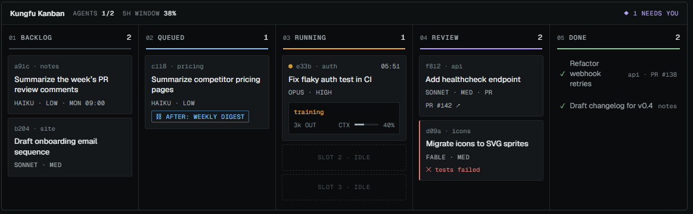

# Kungfu Kanban 🥋

[](https://github.com/LeahyCC/kungfu-kanban/actions/workflows/test.yml)
[](https://github.com/LeahyCC/kungfu-kanban/releases)
[](package.json)
[](CONTRIBUTING.md)
[](LICENSE)

<picture>
  
</picture>

Kungfu Kanban is a local kanban board where every card is a Claude Code agent.
You stay in one Claude Code session and hand the work out as cards. Each card
runs in its own fresh session, on the model it needs, and comes back as a pull
request.

That split is the reason to use it. The session you are steering holds the plan
and the results. The file reads, test logs and diffs stay in the cards. So your
session stays small for the whole backlog: it costs less per turn and it doesn't
compact halfway through. Everything runs on your Claude subscription login, with
no API keys and no per-token billing.

> A tool for one person, by design: single-user, local-first, everything in a folder
> of JSON on your own machine. There is no hosted version and there won't be one.

[Docs](docs/README.md) · [Website](https://kungfu-kanban.com) ·
[Compare](https://kungfu-kanban.com/compare) ·
[Releases](https://github.com/LeahyCC/kungfu-kanban/releases) ·
[Issues](https://github.com/LeahyCC/kungfu-kanban/issues)

---

## Why it saves tokens

```
One long session                       With the board

┌───────────────────────────┐          ┌────────────────┐
│ the plan                  │          │ the plan       │  your session:
│ task 1  files, logs, diff │          │ card results   │  stays small
│ task 2  files, logs, diff │          └───────┬────────┘
│ task 3  files, logs, diff │                  │ cards
│ task 4  ...               │          ┌───────┼────────┐
│ (compacted, plan fades)   │          ▼       ▼        ▼
└───────────────────────────┘        haiku   sonnet    opus
  every turn re-reads all of it      fresh   fresh     fresh
```

- **Your main session stays small.** It holds the plan and what each card came
  back with. The digging happens in the card and stays there.
- **Every card starts fresh.** A card gets its own prompt and nothing from your
  conversation, so task six doesn't pay to re-read tasks one to five.
- **Cheap models do the easy cards.** Model and effort are set per card: haiku
  for chores, opus only where it earns it.
- **Fixes resume, they don't restart.** A follow-up or a CI fix reopens the
  card's own session, so the agent keeps what it already learned.
- **You can watch the spend.** A usage meter for the 5-hour window, plus live
  tokens and context use on every running card.

There is no benchmark behind this, only the mechanism, and a two-line fix is
still cheaper in the session you already have open. The board pays off when the
work is a list. The full reasoning is in
[How the board saves tokens](docs/token-savings.md).

---

## Quick start

```bash
git clone https://github.com/LeahyCC/kungfu-kanban.git && cd kungfu-kanban
npm install
npm start          # → http://localhost:4747
```

That's it for local use. The server binds `127.0.0.1` only. To use the board
from your phone, see [Phone access](docs/phone.md).

**Updating**: the status line shows your board version and checks `origin/main`
every 30 minutes. When your clone is behind, an **⬆ update available** button
pulls, runs `npm ci` if needed and restarts the server. It waits while cards
are running. See
[CHANGELOG.md](CHANGELOG.md) for what changed.

## Requirements

| Thing                                               | Why                                                          | Check                                                  |
| --------------------------------------------------- | ------------------------------------------------------------ | ------------------------------------------------------ |
| **Node 20+**                                        | server runtime                                               | `node -v`                                              |
| **Claude Code CLI**, logged in on your subscription | runs every card                                              | `claude --version`, then `claude` → `/login` if needed |
| **git**                                             | worktree isolation for repo cards                            | `git -v`                                               |
| **GitHub CLI (`gh`)**, authed                       | only for "Open PR when done"                                 | `gh auth status`                                       |
| **macOS**                                           | desktop notifications (`osascript`); the rest works anywhere | n/a                                                    |
| **Tailscale** (optional)                            | use the board from your phone                                | `tailscale status`                                     |

## How a batch runs

1. In any Claude Code session, say "create a kungfu todo for ...". The bundled
   `kungfu-todo` skill writes the cards and drops them in the board's inbox. You
   can also paste Markdown into the board or pull in GitHub issues.
2. Cards launch, up to the **parallel** cap. A card that depends on another
   waits until that one has merged.
3. Each repo card works in its own git worktree and opens a real pull request.
   The board watches its CI.
4. Your session reviews the PR and merges it once you say go. The board then
   removes the worktree and the branch.

The board also has its own LLM manager, the Sensei, which can triage, review
and merge for you. It ships off, because the session you are already talking to
does that job. See [The Sensei](docs/sensei.md).

## Docs

| Doc | What is in it |
| --- | --- |
| [How the board saves tokens](docs/token-savings.md) | Why cards cost less than one long session, and where they don't |
| [Architecture](docs/architecture.md) | The server, the CLI, worktrees and PRs in one diagram |
| [The board](docs/board.md) | Columns, the card drawer, the built-in terminal, archiving, follow-ups |
| [Cards](docs/cards.md) | Card fields, skills, dependencies, scheduled cards |
| [Importing cards](docs/importing.md) | The Markdown format, the watch folder, the `kungfu-todo` skill |
| [Repo cards and PRs](docs/pull-requests.md) | Worktrees, PR watch, the auto-fixers |
| [Contracts](docs/contracts.md) | Files one card publishes for other cards to build against |
| [The Sensei](docs/sensei.md) | The optional LLM manager |
| [Subscription limits](docs/limits.md) | Cooldown and model fallback |
| [Notifications](docs/notifications.md) | macOS, phone pushes, the error tracker |
| [Reports](docs/reports.md) | Flow numbers and shadow model routing |
| [Phone access](docs/phone.md) | Token gate, Tailscale, install as an app |
| [Run at login](docs/run-at-login.md) | The launchd agent on macOS, the supervisor on Windows |
| [Configuration](docs/configuration.md) | Environment variables and the files in `data/` |
| [Troubleshooting](docs/troubleshooting.md) | Common failures and fixes |
| [Security notes](docs/security-notes.md) | What the board can run, and how it is locked down |

## Status & contributions

This is a personal tool that happens to be public, and it's open to
contributions: bug reports, fixes, focused features (issue first), docs and
tests. The scope is narrow on purpose. It is single-user, local-first, runs on
subscription auth and runs code on your own machine. Ideas that would make it a
different tool (multi-tenancy, hosted deployment, API-key providers, a database,
billing) are out of scope. That version existed and was deleted on purpose.

See [CONTRIBUTING.md](CONTRIBUTING.md) for the fork-and-PR workflow, and
[SECURITY.md](SECURITY.md) if you've found a vulnerability. Report it privately
through GitHub, not as a public issue.

## Credits

The board auto-installs two third-party Claude Code skills onto new cards:

- [ponytail](https://github.com/DietrichGebert/ponytail) (MIT): the
  lazy-senior-dev discipline that keeps agent diffs minimal.
- [humanizer](https://github.com/blader/humanizer) (MIT): strips AI writing
  tells from PR titles, descriptions and result summaries. Its patterns come
  from Wikipedia's WikiProject AI Cleanup.

## License

[MIT](LICENSE)
