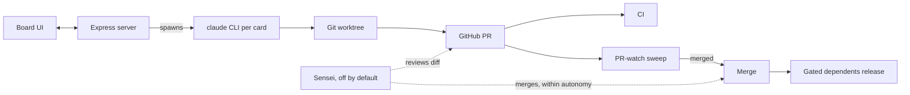

# Architecture at a glance

An Express server (`server.js`) serves the board UI and spawns
`claude -p <prompt> --output-format stream-json` once per card. Output streams
into the card's transcript over server-sent events. Everything persists as JSON
files in `data/`.

The Sensei is an LLM manager (its own `claude -p` call) that reviews a card's
actual diff and merges the ones that pass, up to whatever autonomy level you've
set it. It ships **off**: out of the box you review and merge, and the
kungfu-todo skill tells the Claude Code session you are talking to that it owns
the cards it creates. Tick one box to hand that back to the board — see
[The Manager](sensei.md).

---

[Back to the docs index](README.md)
